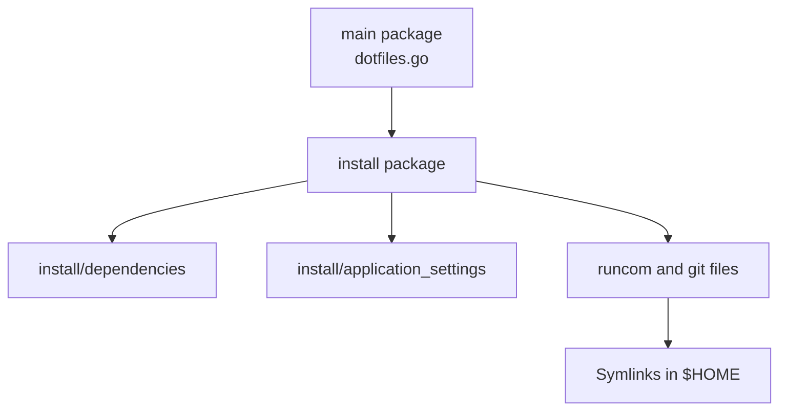
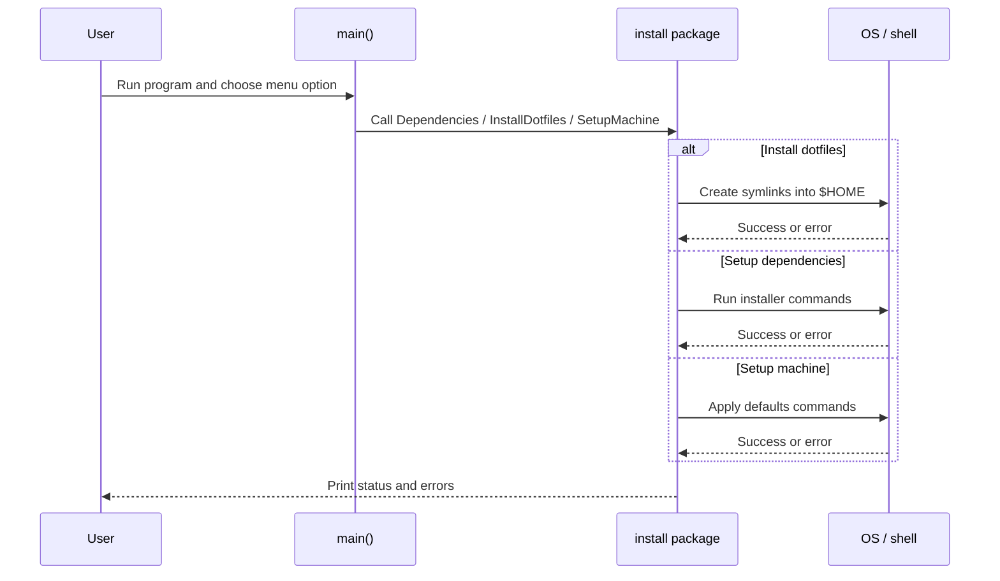
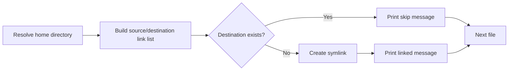
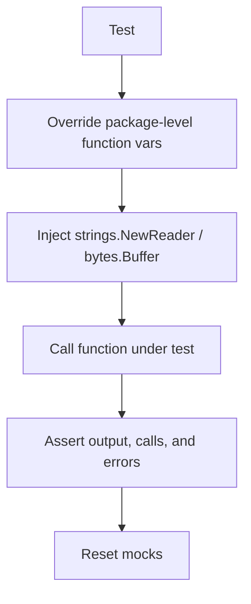

# Architecture

This repository is a Go-based dotfiles and machine bootstrap project. It combines checked-in shell/configuration files with Go code that installs dependencies, symlinks dotfiles into `$HOME`, and applies machine-specific defaults.

## High-level structure

```text
.dotfiles/
├── dotfiles.go                  # CLI entrypoint and top-level menu
├── dotfiles_test.go             # tests for main menu dispatch
├── install/
│   ├── bootstrap_macos.sh       # blank-slate macOS bootstrap before the repo is cloned
│   ├── setup_dev_dependencies.go
│   ├── setup_dotfiles.go
│   ├── setup_machine.go
│   ├── application_settings/    # command builders for macOS/Chrome/Dock settings
│   └── dependencies/            # installers for Homebrew, zsh, git, gh, asdf
├── runcom/                      # shell startup files symlinked into $HOME
├── git/                         # git config files symlinked into $HOME
├── system/                      # shell helper fragments and prompts
├── README.md                    # lightweight setup notes
├── Agent.md                     # contributor workflow guidance
└── Architecture.md              # this file
```

## Package map



### Responsibilities

- `main`
  - Prints the top-level menu.
  - Reads one user selection.
  - Dispatches to the `install` package.

- `install`
  - Coordinates the main behaviors:
    - blank-slate macOS bootstrap via `install/bootstrap_macos.sh`
    - dependency installation
    - dotfile symlink creation
    - machine setup flows
  - Owns most user interaction and error reporting.

- `install/dependencies`
  - Contains installers/checkers for development tools such as Homebrew, zsh, git, GitHub CLI, and asdf.
  - Wraps shell execution behind mockable shims for unit tests.

- `install/application_settings`
  - Builds macOS, Chrome, and Dock commands as plain Go data.
  - Keeps command definitions separate from execution.

- `runcom/`, `git/`, `system/`
  - Store the actual dotfiles and shell fragments managed by the repo.
  - `runcom/` and `git/` are linked into the home directory by the installer code.
  - `runcom/.tool-versions` is copied into `$HOME` so `asdf` can manage tool versions without mutating the checked-in file.

## Runtime flow



## Dotfile installation flow



## Testing architecture

The repository is deliberately structured for unit testing.



Common seams used by tests:

- `io.Reader` and `io.Writer` parameters for interactive code.
- Package-level function variables for OS or command behavior.
- Reset helpers such as `resetDotfilesMocks` and `resetOSXDefaultsMocks`.

## Repository layout and data ownership

There are two kinds of assets in this repo:

1. Declarative configuration files
   - Shell files in `runcom/`
   - Git files in `git/`
   - Shell helper files in `system/`

2. Imperative setup code
   - Go code in `dotfiles.go` and `install/...`
   - Responsible for wiring, prompting, command execution, and symlink creation

This split keeps the managed files readable while allowing installation/setup logic to evolve independently.

## Coding style

The codebase follows a straightforward Go style with a few notable conventions.

### 1. Prefer explicit seams for side effects

OS and shell interactions are usually hidden behind package-level variables or thin wrappers so tests can swap them out.

Examples:

- `runCommand`
- `runCommandOutput`
- `execCommand`
- `execLookPath`
- `userHomeDir`

This is a core pattern in the repo and should be preserved for new code.

### 2. Keep user interaction injectable

Interactive flows tend to accept `io.Reader` and `io.Writer` rather than reading directly from stdin/stdout everywhere. This makes behavior easy to test without a real terminal session.

### 3. Return contextual errors

When commands fail, the code often wraps the error with the command name and arguments. Prefer:

```go
return fmt.Errorf("%s %s: %w", command.Name, strings.Join(command.Args, " "), err)
```

That style keeps failures actionable during machine setup.

### 4. Use comments sparingly but purposefully

Most code is self-explanatory and lightly commented. Comments are used where they add context, such as:

- why a command is allowed to fail
- why a specific macOS setting exists
- what a test seam is for

### 5. Keep tests close to behavior

Tests are colocated with the code they verify and focus on behavior rather than implementation detail:

- output text
- selected command execution
- skipped operations
- error handling branches

### 6. Favor simple control flow

The repository uses simple switches, small helper functions, and explicit loops. New code should stay readable and avoid unnecessary abstraction.

## Change guidance

When adding features or refactoring:

- keep command-building logic separate from command execution when possible
- add tests before changing behavior
- preserve existing menu and output behavior unless intentionally changing UX
- avoid introducing new tooling unless the repository already uses it
- finish by running `go test ./...`
